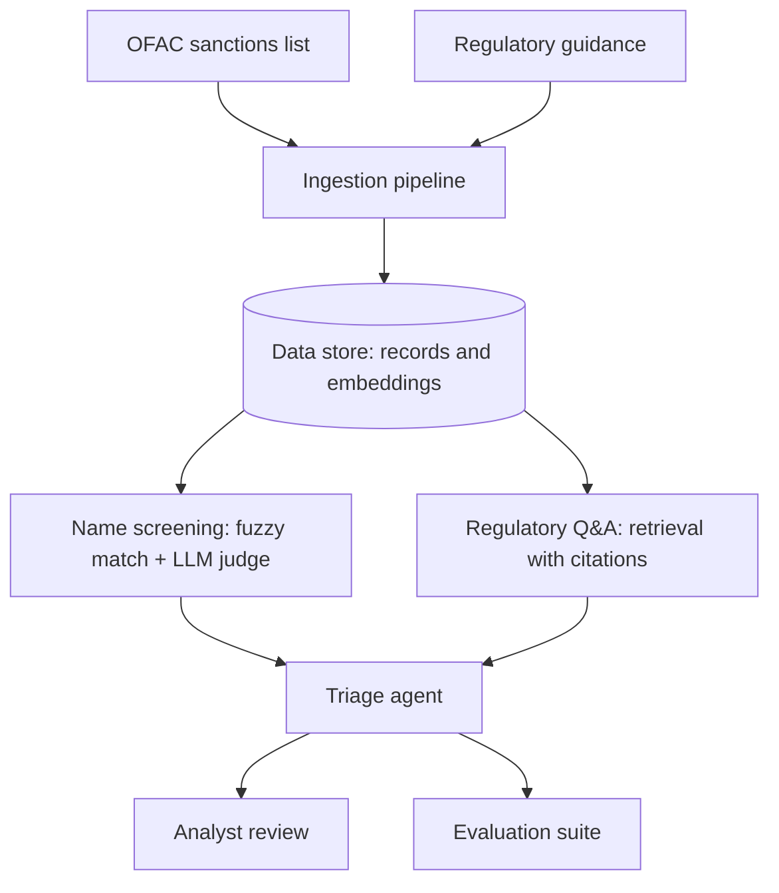

# Compliance Copilot

An AI assistant for sanctions screening and regulatory Q&A, built on public
data only (the OFAC SDN list and published FinCEN guidance).

**Status:** milestone 2 in progress — fuzzy name screening is working; the
LLM review step is next.

## Architecture



- **Ingestion** downloads and cleans public data into consistent records.
- **Name screening** uses cheap fuzzy matching to find candidates, then an
  LLM reviews each one and explains its decision.
- **Regulatory Q&A** retrieves relevant passages first, so answers are
  grounded in the documents and cite them.
- **Triage agent** combines both to draft a recommended disposition for an alert.
- **Analyst review** keeps a human as the decision-maker.
- **Evaluation suite** scores every change against labeled test cases.

## Roadmap

| Milestone | What | Status |
|---|---|---|
| 1 | Ingest the OFAC SDN list into clean records | ✅ |
| 2 | Name screening: fuzzy matching, then an LLM judges and explains each hit | 🔨 fuzzy matching done |
| 3 | Regulatory Q&A with citations (RAG) | |
| 4 | Alert-triage agent with tool calling | |
| 5 | Evaluation set and accuracy report | |
| 6 | Demo UI and write-up | |

## Run it

```bash
python -m venv .venv
source .venv/bin/activate        # Windows: .venv\Scripts\activate
python -m pip install -r requirements.txt

python -m pytest                                              # run the tests
python -m copilot.ingest --source data/sample/sdn_sample.csv  # sample data
python -m copilot.ingest                                      # live OFAC list
python -m copilot.screen "Jon Doe"                            # screen a name
```

Ingestion writes `data/processed/sdn.jsonl`, one JSON record per line.
Screening reads that file and lists the closest names with a 0-100 score.
Options: `--threshold` (default 80) and `--limit` (default 10).

## Layout

```
copilot/ingest.py     download and parse the SDN list
copilot/screen.py     fuzzy name screening
data/sample/          small fictional sample used by the tests
tests/                pytest tests
```

## Python notes for Java developers

| Python here | Java equivalent |
|---|---|
| `.venv` + `requirements.txt` | a per-project Maven dependency set |
| `@dataclass class SdnEntry` | a `record` |
| `python -m pytest` | `mvn test` |
| `python -m copilot.ingest` | running a class with a `main` method |
| `list[str]`, `-> list[SdnEntry]` | generics and return types (hints only, not enforced) |

## Data note

The sample file contains invented entries. The live list is published by the
US Treasury and is not committed to this repo.
